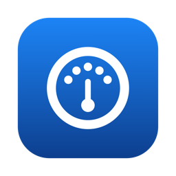
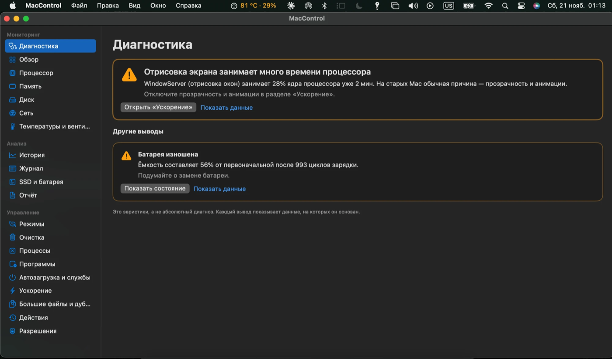
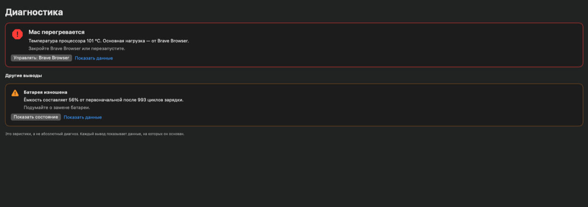
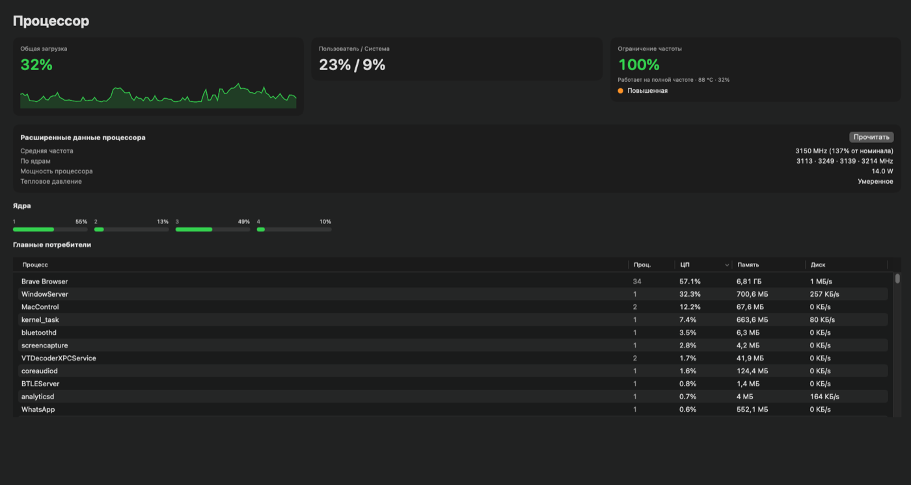
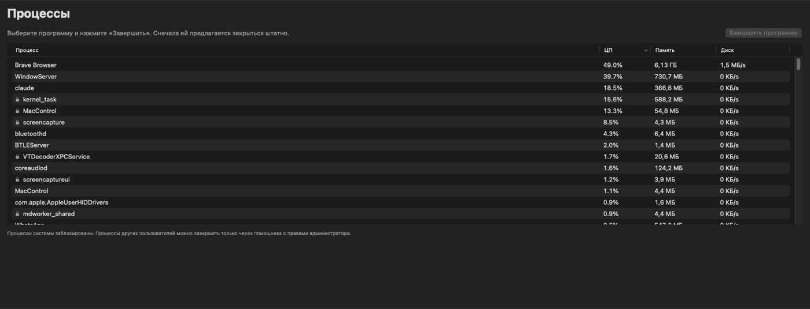
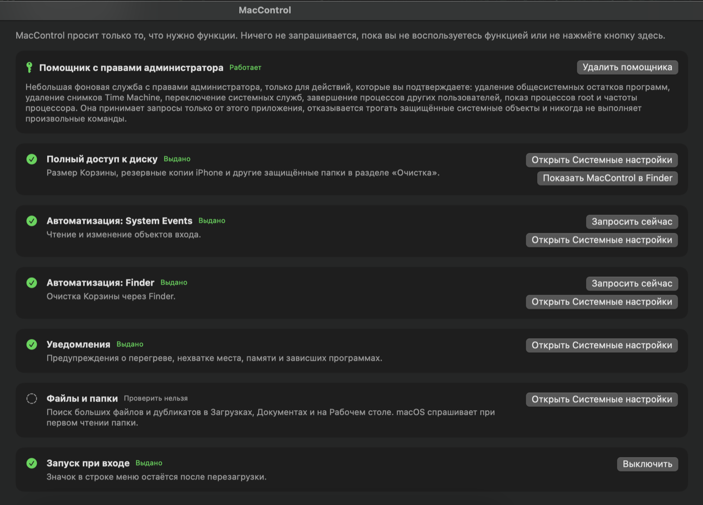

<div align="center">



# MacControl

**Центр управления старым Mac: что тормозит, что греется, почему — и что с этим делать.**

Мониторинг · диагностика простым языком · ускорение · безопасная очистка

[](https://github.com/mr-rt95/MacControl/actions/workflows/ci.yml)


[**⬇ Скачать MacControl**](https://github.com/mr-rt95/MacControl/releases/latest) · [Руководство](docs/USER_GUIDE.md) · [English](#english)



</div>

## Что это

MacControl — бесплатное приложение для Mac на процессоре **Intel** (примерно 2012–2019 годов), которые со временем стали медленнее и горячее. Оно не просто показывает цифры, а **отвечает на вопрос «что не так»**:

> *«Mac перегрет и сбрасывает частоту. Причина — Brave Browser. Закройте его или перезапустите.»*

Каждый вывод сопровождается данными, на которых он основан, и безопасным действием. Всё работает **локально**: данные не покидают компьютер, учётная запись не нужна. Само приложение почти не нагружает систему (около 30 МБ памяти).

## Скачать и установить

1. Откройте страницу [**Releases**](https://github.com/mr-rt95/MacControl/releases/latest) и скачайте **`MacControl-0.1.0.dmg`**.
2. Откройте скачанный файл и **перетащите MacControl в папку «Программы»**.
3. Запустите MacControl из «Программ». Значок появится в строке меню, например `81 °C · 29%`.

### Если macOS предупреждает при первом запуске

Приложение подписано, но пока не прошло платную нотаризацию Apple, поэтому macOS просит подтвердить первый запуск. Это нужно сделать один раз:

- **macOS 12–14:** в «Программах» нажмите на MacControl **правой кнопкой ▸ «Открыть» ▸ «Открыть»**.
- **macOS 15 и новее:** попробуйте открыть приложение, затем **Системные настройки ▸ Конфиденциальность и безопасность ▸ «Всё равно открыть»**.
- Либо одной командой в Терминале:
  ```bash
  xattr -dr com.apple.quarantine /Applications/MacControl.app
  ```

### Удаление

Перетащите MacControl из «Программ» в Корзину. Если устанавливали помощника с правами администратора, сначала нажмите «Удалить помощника» в разделе «Разрешения». Данные приложения лежат в `~/Library/Application Support/MacControl`.

## Что умеет

| Раздел | Что делает |
|---|---|
| **Диагностика** | Главный экран: «всё в порядке» или причина тормозов с виновником, данными и советом. Перегрев, троттлинг, перегрузка процессора, нехватка памяти и места, плохое охлаждение, износ батареи и SSD |
| **Мониторинг** | Процессор по ядрам, память, диск, сеть, температуры и вентиляторы, значок в строке меню |
| **История и журнал** | Графики за час, сутки и неделю; журнал «что тормозило вчера» |
| **SSD и батарея** | Статус SMART, износ SSD (ресурс, объём записи), циклы и износ батареи |
| **Режимы** | «Тихий» (меньше нагрев и шум) и «Производительность» |
| **Очистка** | Кэши, журналы, временные файлы, старые загрузки, кэши разработчика, копии iPhone |
| **Процессы и программы** | Мягкое завершение, удаление программ вместе с остатками |
| **Автозагрузка и службы** | Отключение без удаления, справка «можно остановить или осторожно» |
| **Ускорение** | Лишние визуальные эффекты — с кнопкой «Вернуть как было» |
| **Большие файлы и дубликаты** | Поиск вручную, предпросмотр, всегда остаётся одна копия |
| **Отчёт** | Сводка для мастера или поддержки (Markdown/HTML), без имён личных файлов |
| **Уведомления** | О перегреве, нехватке места, памяти и зависших программах — без спама |

## Скриншоты

<table>
<tr>
<td width="50%"><br><sub>Перегрев: что виновато и что делать</sub></td>
<td width="50%"><br><sub>Процессор: частоты, мощность, тепловое давление</sub></td>
</tr>
<tr>
<td width="50%"><br><sub>Процессы: системные защищены замком</sub></td>
<td width="50%"><br><sub>Разрешения: что нужно приложению и зачем</sub></td>
</tr>
</table>

## Безопасность превыше всего

- **Ничего не удаляется безвозвратно.** Всё переносится в Корзину, ведётся журнал действий с кнопкой «Отменить». Единственное исключение — очистка самой Корзины: её выполняет Finder со своим подтверждением.
- **Всегда предпросмотр.** Перед любым действием показывается точный список файлов и общий размер. Ничего не выбрано заранее.
- **Системное защищено и не отключается:** `/System`, `/usr`, `/bin`, `/sbin`, `/private`, системная `/Library`, программы Apple, критичные процессы (`kernel_task`, `launchd`, `WindowServer`…). Документы, Рабочий стол и Изображения никогда не очищаются автоматически.
- **Честность.** Если датчика на вашей модели нет, приложение так и пишет. Выводы — это эвристики, а не абсолютный диагноз.

## Помощник с правами администратора (по желанию)

Нужен для действий вне вашей учётной записи: остатки программ в `/Library`, локальные снимки Time Machine, системные службы, процессы других пользователей и root, частота процессора. Устанавливается кнопкой в разделе «Разрешения» ▸ «Установить помощника» и подтверждается в Системных настройках. Принимает запросы только от самого MacControl, выполняет фиксированный список действий и отказывается трогать защищённые объекты. Подробности: [docs/HELPER.md](docs/HELPER.md). Требуется macOS 13+.

## Требования и ограничения

- **Mac с процессором Intel**, macOS 12 Monterey и новее. На Mac с чипами Apple (M1 и новее) приложение не поддерживается: датчики там читаются иначе.
- Приложение разрабатывалось и проверялось на **MacBook Pro 14,1 (2017) с macOS 13.7**. На других моделях набор датчиков может отличаться: недоступные честно помечаются «Нет данных». Если у вас что-то не читается, [создайте issue](https://github.com/mr-rt95/MacControl/issues) и приложите вывод `MacControlProbe --stats --all-keys`.
- Управление оборотами вентиляторов и частотой процессора не поддерживается: это рискованно для оборудования.
- Без прав администратора видны только процессы текущего пользователя (с помощником — все).
- Язык интерфейса: русский и английский.

## Частые вопросы

**Приложение платное?** Нет, MIT-лицензия, исходный код открыт.

**Почему macOS ругается на первый запуск?** Нотаризация Apple требует платной подписки разработчика ($99 в год). Приложение подписано сертификатом разработчика, исходный код открыт, а подтвердить запуск нужно один раз.

**Безопасно ли давать «Полный доступ к диску»?** Он нужен только чтобы показать размер Корзины и копий iPhone в «Очистке». Приложение работает без него, остальное не изменится.

**Куда уходят мои данные?** Никуда. Приложение не использует сеть, у него нет сервера и аналитики. История и журнал хранятся в `~/Library/Application Support/MacControl`, их можно очистить в «Настройках».

## Для разработчиков

Swift 5.7+, SwiftUI + AppKit, без сторонних зависимостей. Нужны Xcode или Command Line Tools.

```bash
git clone https://github.com/mr-rt95/MacControl.git && cd MacControl
./build.sh run        # собрать и запустить (build/MacControl.app)
./build.sh test       # тесты (нужен Xcode)
Scripts/doctor.sh     # проверка окружения
```

```
Sources/
  MacControlCore/   сбор данных, диагностика, безопасность, действия (без UI)
  MacControl/       приложение: SwiftUI-экраны, строка меню
  MacControlHelper/ демон с правами администратора (XPC)
  MacControlProbe/  консольная диагностика датчиков для тестеров
  CLibProc, CNVMe/  тонкие C-обёртки (libproc, NVMe SMART)
Tests/              88 модульных тестов
docs/               руководство, помощник, выпуск
```

Сборка релиза и DMG: [docs/RELEASE.md](docs/RELEASE.md). Вклад приветствуется: [CONTRIBUTING.md](CONTRIBUTING.md). Безопасность: [SECURITY.md](SECURITY.md).

---

<a name="english"></a>
## English

**MacControl** is a free all-in-one monitoring, diagnostics, tuning and cleanup app for **Intel Macs (≈2012–2019)** that have become slow and hot. Instead of just showing numbers it tells you *why* the Mac is slow ("Your Mac is overheating and slowing itself down. The cause is Brave Browser. Close it or restart it.") and offers a safe action. Everything stays local — no account, no network.

**Install:** download `MacControl-0.1.0.dmg` from [Releases](https://github.com/mr-rt95/MacControl/releases/latest), drag MacControl to *Applications*, and on first launch right-click ▸ *Open* (the app is code-signed but not yet notarized by Apple). Requires an Intel Mac and macOS 12+. The interface is in Russian and English.

**Safe by design:** nothing is deleted permanently (everything goes to the Trash with a preview and an undo log), system paths and critical processes are protected, and every conclusion shows the data behind it. An optional administrator helper handles actions that need root; it only accepts requests from the app itself.

Built with Swift/SwiftUI, MIT licensed. See [docs/](docs/) and [CONTRIBUTING.md](CONTRIBUTING.md).

## Лицензия

[MIT](LICENSE)
